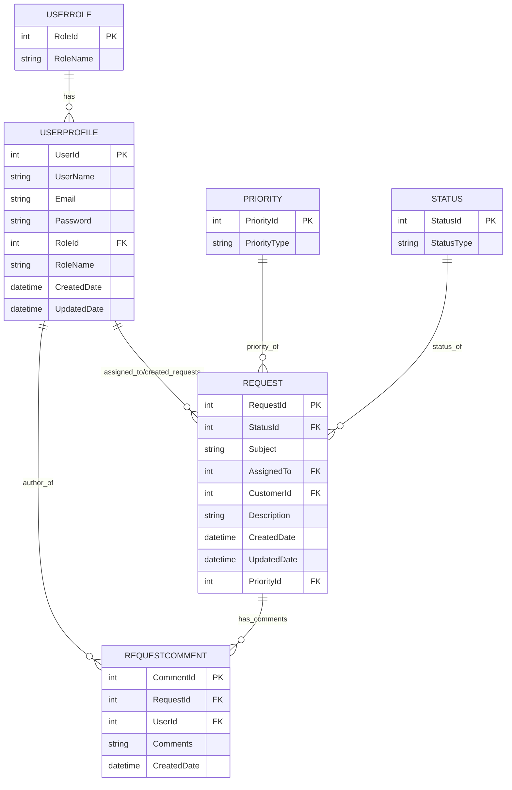

# Database ER Diagram (Mermaid)

This file contains an Entity-Relationship diagram (Mermaid) for the application's database model as defined in CustomerSupportContext and the model classes.

To render the diagram you can paste the Mermaid block into any Mermaid renderer (VS Code with Mermaid Preview, mermaid.live, or GitHub Markdown preview for mermaid-enabled renderers).

Summary of relationships
- UserRole (1) — (N) UserProfile via RoleId
- UserProfile (1) — (N) Request (as Customer via CustomerId)
- UserProfile (1) — (N) Request (as AssignedTo via AssignedTo)
- Request (1) — (N) RequestComment via RequestId
- UserProfile (1) — (N) RequestComment via UserId
- Priority (1) — (N) Request via PriorityId
- Status (1) — (N) Request via StatusId

Notes
- The diagram reflects the EF Core model (CustomerSupportContext.OnModelCreating).
- Primary/foreign keys, nullable FKs and required relationships are indicated by FK labels; Status and Role relationships are configured as required in the model where noted.
- If you want a PNG/SVG export, open this file in a Mermaid-capable renderer and export the diagram.
